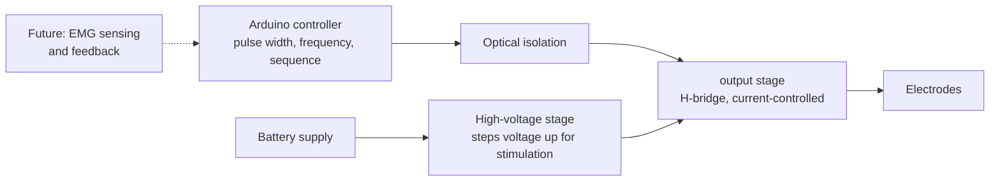

# FES-Stimulator: A Biphasic Functional Electrical Stimulation Prototype for Neurorehabilitation

A prototype functional electrical stimulation (FES) system designed to support rehabilitation for people with motor impairments, such as those caused by stroke. It generates controlled, charge-balanced (biphasic) current pulses that can activate muscles when the person cannot move them voluntarily.

> **Note on scope:** this was developed as an industry project, so detailed schematics, component values, firmware and test data are confidential and are not published here. This repository describes the purpose, architecture and design approach at a high level. <!-- Name the company here only if you have permission -->

> **Safety warning:** this is an early-stage prototype. It has **not** been validated, has **not** been tested on people, and is **not** a medical device. It involves high-voltage stimulation and must not be built, copied or connected to a person on the basis of this description.


---

## Background

After a stroke, many people lose the ability to move parts of their body, such as an arm or hand, voluntarily. The muscles may still be intact, but the signal from the brain no longer reaches them reliably.

Functional electrical stimulation (FES) is used in rehabilitation to help with this. Electrodes placed on the skin deliver small, carefully shaped electrical pulses to the nerves and muscles, causing the muscle to contract and the limb to move. This lets a patient practise movements they cannot produce on their own, and helps keep the muscles active during recovery.

## What this project is

The goal was to design a stimulator that is **programmable, safe by design, and modular**:

- **charge-balanced pulses:** each pulse is designed so the net charge delivered is zero. This avoids a net DC component, which can damage tissue and degrade electrodes over time.
- **Current-controlled output:** skin and tissue resistance varies a lot between people, electrode placement, and even moisture levels. Controlling the current rather than the voltage keeps the stimulation consistent despite these changes.
- **Programmable timing:** pulse width, frequency, and timing sequences can be configured in firmware, so different stimulation patterns can be tried.
- **Isolation:** keeping the controller electrically separated from the patient-connected stage was a central design consideration, using optical isolation between the two sides.
- **Modular design:** the hardware is arranged so that EMG sensing and feedback-controlled stimulation can be added later. And a single device can be used for all kinds of applications.

## System overview



1. **Power:** a low-voltage battery supplies the system, and a high-voltage stage raises it to the level needed to drive stimulation pulses through skin.
2. **Control:** an Arduino sets the pulse timing: how wide each pulse is, how often it repeats, and the on/off sequence of stimulation.
3. **Isolation:** optical isolators pass the timing signals across without a direct electrical connection between the controller and the patient side.
4. **Output:** an H-bridge stage switches the current direction to produce the positive and negative phases of each pulse, while limiting the current.
5. **Delivery:** the pulses reach the muscle through surface electrodes.

## Development approach

- Circuit concepts for the high-voltage and H-bridge stages were modelled in circuit simulation software during design exploration. The simulation was used to explore the concept and **should not be treated as verified**; the design was iterated and parts of it have been reworked.
- Stimulation control logic was developed on Arduino, covering configurable pulse widths, frequencies and timing sequences.
- Hardware was built up through iterative prototyping. <!-- Add an oscilloscope capture of the output waveform here if you have one, since measured results are worth more than simulation -->

## What I learned

- How biphasic, charge-balanced stimulation works, and why current control and safety features matter so much in a device that touches the body
- Designing and using optical isolation in a patient-connected circuit
- Timing and control of pulse waveforms from a microcontroller
- Gathering requirements and feedback from stakeholders, and turning clinical needs into design decisions

## Future work

- Measured waveform characterisation on a test load (resistor network) before any further stages
- EMG sensing so stimulation can respond to the person's own muscle activity
- Closed-loop, feedback-controlled stimulation
- Integration with a 3D-printed lattice cast that has openings for electrodes (see my KAST project) <!-- Link to the KAST repo -->
- Review against medical electrical safety standards (such as the IEC 60601 family) before any use on people

## Repository contents

```
FES-Stimulator/
├── README.md
└── images/      # prototype photos and block diagrams
```

